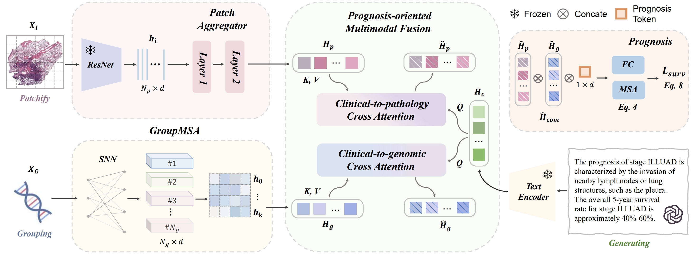

Clinical Stage Prompt Induced Multi-Modal Prognosis
===========
<details>
<summary>
  <b>Clinical Stage Prompt Induced Multi-Modal Prognosis</b>, IEEE Transactions on Medical Imaging.
  <a href="https://ieeexplore.ieee.org/abstract/document/11080170" target="blank">[HTML]</a>
  <br><em>Ting Jin, Xingran Xie, Qingli Li, Xinxing Li, and Yan Wang</em></br>
</summary>

```bash
@ARTICLE{11080170,
  author={Jin, Ting and Xie, Xingran and Li, Qingli and Li, Xinxing and Wang, Yan},
  journal={IEEE Transactions on Medical Imaging}, 
  title={Clinical Stage Prompt Induced Multi-Modal Prognosis}, 
  year={2025},
  volume={44},
  number={12},
  pages={5065-5076}
}
```
</details>

**Summary:** Histology analysis of the tumor micro-environment integrated with genomic assays is widely regarded as the cornerstone for cancer analysis and survival prediction. This paper jointly incorporates genomics and Whole Slide Images (WSIs), and focuses on addressing the primary challenges involved in multi-modality prognosis analysis: 1) the high-order relevance is difficult to be modeled from dimensional imbalanced gigapixel WSIs and tens of thousands of genetic sequences, and 2) the lack of medical expertise and clinical knowledge hampers the effectiveness of prognosis-oriented multi-modal fusion. Due to the nature of the prognosis task, statistical priors and clinical knowledge are essential factors to provide the likelihood of survival over time, which, however, has been under-studied. To this end, we propose a prognosis-oriented image-omics fusion framework, dubbed Clinical Stage Prompt induced Multimodal Prognosis (CiMP). Concretely, we leverage the capabilities of the advanced LLM to generate descriptions derived from structured clinical records and utilize the generated clinical staging prompts to inquire critical prognosis-related information from each modality intentionally. In addition, we propose a Group Multi-Head Self-Attention module to capture structured group-specific features within cohorts of genomic data. Experimental results on five TCGA datasets show the superiority of our proposed method, achieving state-of-the-art performance compared to previous multi-modal prognostic models. Furthermore, the clinical interpretability and discussion also highlight the immense potential for further medical applications.



## Acknowledgements
We thank these great works and open-source codebases:
* Whole Slide Image Classification. [TransMIL](https://github.com/szc19990412/TransMIL).
* Multimodal Survival Prediction. [CLAM](https://github.com/mahmoodlab/CLAM), [PORPOISE](https://github.com/mahmoodlab/PORPOISE).

## License & Usage 
If you find our work useful in your research, please consider citing our paper at:
```bash
@ARTICLE{11080170,
  author={Jin, Ting and Xie, Xingran and Li, Qingli and Li, Xinxing and Wang, Yan},
  journal={IEEE Transactions on Medical Imaging}, 
  title={Clinical Stage Prompt Induced Multi-Modal Prognosis}, 
  year={2025},
  volume={44},
  number={12},
  pages={5065-5076}
}
```

© [Mahmood Lab](http://www.mahmoodlab.org) - This code is made available under the GPLv3 License and is available for non-commercial academic purposes. 
